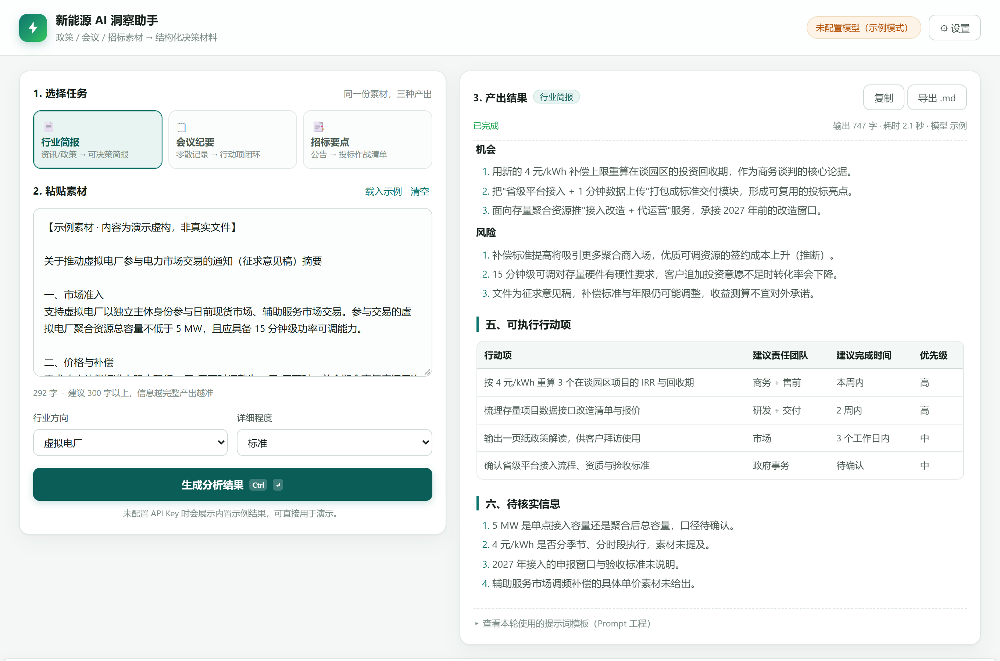

# 新能源 AI 洞察助手 · InsightCopilot

> 面向新能源行业（光伏 / 储能 / 虚拟电厂 / 综合能源）业务团队的 AI 工作台：
> 把**政策资讯、会议记录、招标公告**三类原始素材，一键转成**能拍板、能转发、能落地**的结构化决策材料。

## 解决什么问题

| 场景 | 原来怎么做 | 用本工具 |
| --- | --- | --- |
| 看到一份行业政策 | 通读 → 手动摘要点 → 写简报（约 1-2 小时） | 粘贴全文 → 30 秒输出可呈报 CEO 的简报 |
| 会议录音转写稿 | 人工整理纪要、追行动项（约 40 分钟） | 自动提炼结论、行动项表（责任人 / 截止 / 交付物） |
| 拿到一份招标公告 | 逐条翻找资质、时间、废标条款 | 自动生成投标作战清单，硬性条款单独点名 |

## 核心功能

- **三种任务模式**：行业简报 / 会议纪要 / 招标要点，各自对应一套精心设计的输出结构
- **可查看的提示词工程**：每轮使用的 System / User 提示词在界面内完全透明可查
- **流式输出**：边生成边渲染，Markdown 表格实时排版
- **多模型接入**：支持所有 OpenAI 兼容接口（DeepSeek / 通义千问 / 智谱 GLM / Kimi / OpenAI），内置一键预设
- **连接测试**：保存前可一键测试 Key 是否可用，失败自动提示排查方向
- **历史记录**：最近 12 次结果存本机，点击即可回填复看
- **导出**：一键复制 / 导出 .md，可直接粘进飞书、腾讯文档、PPT 大纲
- **示例模式**：不配置 API Key 也能完整演示（内置虚构示例素材与结果），适合现场展示

## 技术实现

- **零依赖单页应用**：原生 HTML / CSS / JavaScript，双击 index.html 即可运行，无需安装任何东西
- **自写轻量 Markdown 渲染器**：支持标题、表格、列表、引用、代码块，流式渲染时增量重建 DOM
- **SSE 流式解析**：fetch + ReadableStream 逐块解析 `data:` 事件，实现打字机效果
- **提示词模板化**：System 固定"分析师人设 + 反编造准则"，User 按模式 / 行业 / 详细程度动态拼装
- **本地存储**：配置、草稿、历史全部存 localStorage，素材不上传第三方

## 使用方法

1. 双击打开 `index.html`（建议先在目录下运行 `python -m http.server 8000` 后访问 http://localhost:8000，避免个别浏览器对本地文件的跨域限制）
2. 点右上角 ⚙ 设置 → 快速选择模型服务商 → 填入 API Key → 测试连接 → 保存
3. 粘贴素材（或点「载入示例」先体验）→ 选任务模式 → 生成
4. 不填 Key 也能用：会播放内置示例结果，功能流程完全一致

## 可拓展方向

- 接入网页抓取（后端代理）实现"贴链接自动取正文"
- 增加虚拟电厂 / 储能行业术语词典，提升专有名词识别准确率
- 行动项与日历 / 待办联动，形成闭环跟踪
- 多文档对比（如新旧政策版本 diff）

---
*注：内置示例素材与示例结果均为演示用虚构内容，非真实政策文件。*
